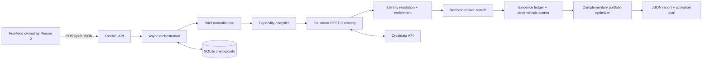

# ALLIOME architecture

## Data flow and trust model

The API persists an analysis before starting work. Each completed stage is stored in `stage_outputs`, allowing earlier work to remain auditable after a later provider failure. SQLite is intentionally the sole persistence layer for the hackathon.

Company identity is deduplicated in priority order: canonical Crustdata company ID, normalized domain, then fallback normalized name. Provider payloads are retained under each company record's `raw` field. The evidence ledger records provider, URL when actually supplied, record ID, field path, retrieval time, status, confidence, and explanation. It never presents a Crustdata field as independent web verification.

## Scoring

All scores range from 0 to 100 and are deterministic for an unchanged record set.

- **Strategic fit:** 65 points of weighted required-capability relevance, plus industry (15/5) and geography (10/4) signals.
- **Activation readiness:** description, scale, and decision-maker evidence; it does not imply commercial willingness.
- **Evidence confidence:** completeness of supported identity fields plus source URL availability.

The portfolio chooser deterministically enumerates the small shortlist (at most eight investigated companies) and chooses the best weighted maximum-coverage combination. It rewards complementary inferred relevance, strategic fit, and evidence confidence while subtracting redundant overlap. It reports verified coverage separately from inferred coverage; a description keyword cannot create 100% verified coverage. Checkpoints are reused after a retry so discovery, enrichment, and people-search calls are not repeated once their stage output was persisted.

## Crustdata implementation

The REST client is separate from the Codex MCP session. It uses environment-provided credentials and `x-api-version: 2025-11-01`, has a concurrency semaphore, timeout, bounded retries for 429 and 5xx responses, and explicit errors for 401, 402, 403, malformed payloads, and timeouts. Discovery comes before enrichment; only canonical, shortlisted records are enriched.

## Intentionally omitted

No Redis, Celery, microservices, external messaging, automatic outreach, or browser credential use. Partnership recommendations and outreach text are drafts/hypotheses only. These omissions keep the vertical slice safe, inspectable, and runnable during ContextCon.
